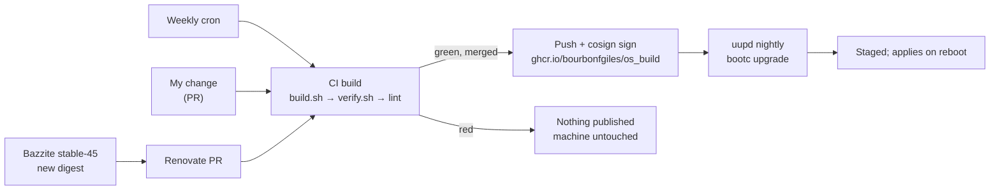

# os_build

My desktop OS as a signed [bootc](https://bootc.dev) image: Bazzite (GNOME, NVIDIA open) with my packages built in, so nothing is ever layered with `rpm-ostree`.

It's one of three repos that build the machine:

| Repo | Owns |
|---|---|
| `os_build` (this) | The OS: packages, drivers, system policy |
| [`dotfiles`](https://github.com/bourbonfgiles/dotfiles) | Me: home config, Homebrew, Flatpaks, GNOME settings, the k3d cluster runtime |
| [`kube_local`](https://github.com/bourbonfgiles/kube_local) | The cluster platform: Cilium, Gateway API, BIND |

> [!NOTE]
> No hardware details are recorded here. Learn the machine from [Inspect the machine](#inspect-the-machine).

## How it works



| File | Does |
|---|---|
| `Containerfile` | `FROM ghcr.io/ublue-os/bazzite-gnome-nvidia-open:stable-45`, runs the two scripts, then `bootc container lint --fatal-warnings` |
| `build_files/build.sh` | Adds build-only repos, installs packages, removes the repos, adds Albert autostart and the signature policy |
| `build_files/verify.sh` | Fails the build if the image could not boot, unlock the drives by passphrase, verify updates, or run what I need |
| `system_files/` | Copied onto `/`. Holds the cosign public key |
| `.github/workflows/build.yml` | Universal Blue's template workflow: build, rechunk, push, sign |
| `.github/renovate.json5` | Bumps the Bazzite digest and merges it when CI is green |

## Inspect the machine

Read-only. Run these first when helping on this machine.

| Question | Command |
|---|---|
| Which image, staged update, rollback target | `sudo bootc status`, `rpm-ostree status` |
| Disks and LUKS layout | `lsblk -o NAME,SIZE,TYPE,FSTYPE,MOUNTPOINTS,MODEL` |
| Keyslots and tokens | `sudo cryptsetup luksDump <device> \| grep -E 'luks2\|tpm2\|Tokens'` |
| Kernel arguments (incl. `rd.luks.uuid`) | `rpm-ostree kargs` |
| Secure Boot and enrolled keys | `mokutil --sb-state`, `mokutil --list-enrolled \| grep Subject:` |
| GPU and driver | `nvidia-smi --query-gpu=name,driver_version --format=csv` |
| USB devices and their autosuspend | `grep -H . /sys/bus/usb/devices/*/{product,power/control} 2>/dev/null` |
| Update runs | `journalctl -u uupd --since -7d` |
| Suspend history | `journalctl --since -14d \| grep -E 'PM: suspend (entry\|exit)'` |

## Rules

1. **Never layer.** No `rpm-ostree install`. A package goes in `build.sh`; a layered package also stops `bootc` upgrading.
2. **Third-party repos are build-only.** The image ships none. Albert's OBS repo uses `Fedora_$releasever`, never Rawhide.
3. **Drives are only unlocked by hand.** Passphrase only: no TPM, FIDO2, keyfiles, `crypttab` entries or automount. `verify.sh` enforces the image side.
4. **Only signed images.** The default policy stays `reject`; this image is trusted by its cosign key.
5. **Native Steam.** StarCraft II runs through Battle.net in a Proton prefix under `~/.local/share/Steam`. Never move Steam to Flatpak.

## What survives what

| | Image update / rollback | Fresh install |
|---|---|---|
| `/usr` (OS, packages) | Replaced by the image | Replaced by the image |
| `/etc` | My changes kept, merged with the image | Lost |
| `/var/home`, Flatpaks, Homebrew, Steam games | Kept, never rolled back | Lost: dotfiles reinstalls apps; games re-download |
| The data drive | Untouched | Untouched, if not selected in the installer |

## Setup (once)

1. Create this repo from `ublue-os/image-template`, **public**, and enable Actions.
2. Keys:
   ```
   COSIGN_PASSWORD="" cosign generate-key-pair
   gh secret set SIGNING_SECRET < cosign.key
   cp cosign.pub system_files/etc/pki/containers/os_build.pub
   ```
   Copy `cosign.key` to encrypted storage off the machine, then delete it from disk. Commit `cosign.pub` and the copy.
3. Push and wait for a green build.
4. GHCR package → **Package settings → Change visibility → Public**. Packages start private, and a private image can't be pulled without registry credentials.
5. Install the Renovate GitHub app. Repo settings: **Allow auto-merge**, and a ruleset on `main` requiring the **Build and push image** check.

## Switch an existing Bazzite to this image

```
cosign verify --key cosign.pub ghcr.io/bourbonfgiles/os_build:latest
sudo ostree admin pin 0
sudo rpm-ostree reset
sudo rpm-ostree rebase ostree-unverified-registry:ghcr.io/bourbonfgiles/os_build:latest
systemctl reboot
```

- `reset` drops layered packages; `bootc` refuses a deployment that has them.
- The rebase skips signature checks once because Bazzite's policy rejects unknown images. The `cosign verify` above is the check.

Test StarCraft II, Albert (Super+Space), Ghostty, `sudo bpftrace -e 'BEGIN { exit(); }'` and the k3d cluster. Then turn on enforced signatures:

```
sudo bootc switch --enforce-container-sigpolicy ghcr.io/bourbonfgiles/os_build:latest
```

After a week or two without trouble: `sudo ostree admin pin --unpin <index>` (find it with `rpm-ostree status`).

## Rebuild from USB

1. On another machine, download the Bazzite ISO (GNOME, NVIDIA) from bazzite.gg and write it with Fedora Media Writer.
2. Install with encryption on.

   > [!CAUTION]
   > Select **only the system disk**. Leave the data drive **unticked** and never choose "reclaim space". Unselected disks are not touched.
   > To tell them apart, run `lsblk -o NAME,SIZE,FSTYPE,MODEL` in the live session: the system disk has EFI, `/boot` and LUKS partitions; the data drive has a single LUKS partition.

3. First boot: enrol the Secure Boot key at the blue MOK screen (password `universalblue`).
4. Switch as above, without `reset` (there is nothing layered), then `bootc switch --enforce-container-sigpolicy`.
5. Run `dotfiles`' `bootstrap.sh`, then bring up `kube_local`.
6. Steam: sign in and re-download. `/var/home` is not restored.

## Day to day

| Task | How |
|---|---|
| Updates | Automatic. Reboot when `bootc status` shows a staged image |
| Update now | `sudo bootc upgrade`, or `--check` to look first |
| Add or remove a package | Edit `PACKAGES` in `build.sh` → PR → merge |
| What's running | `sudo bootc status`, `rpm-ostree status` |
| Roll back | `sudo bootc rollback` then reboot, or pick the previous GRUB entry |
| Fedora 46 | Pin, then PR `stable-45` → `stable-46`. Red usually means Albert's OBS has no `Fedora_46` build yet; wait |
| Rotate the cosign key | Add the new public key next to the old one (two `keyPath` entries via `keyPaths`), build, switch `SIGNING_SECRET`, build, then remove the old key |

## Encryption

Both drives are LUKS2 with one passphrase keyslot and no tokens.

| Drive | Unlocked by | Protected by |
|---|---|---|
| System | Passphrase prompt in the initramfs, from `rd.luks.uuid` | `verify.sh`: the initramfs must contain `crypt`, `systemd-cryptsetup`, `btrfs` and `dm-crypt.ko`; the previous deployment stays bootable |
| Data | By hand in Files (udisks) | Nothing in the OS refers to it; `verify.sh` fails on `crypttab` entries, keyfiles or enabled `systemd-cryptsetup@` units |

Passphrases are in my head and my password manager; header backups (one per drive, named by role and LUKS UUID) are in encrypted storage off the machine.

```
sudo cryptsetup luksDump <device> | grep -E 'luks2|tpm2|Tokens'
sudo cryptsetup luksHeaderBackup <device> --header-backup-file <name>.img
```

Take a header backup again after changing any passphrase or keyslot.

> [!WARNING]
> Never run `systemd-cryptenroll`, `cryptsetup luksFormat`, `luksKillSlot` or `luksRemoveKey` without a current header backup and the passphrase to hand.

## Troubleshooting

Start with `sudo bootc status` and `journalctl -u uupd -b`.

| Symptom or message | Where | Cause | Fix |
|---|---|---|---|
| `Could not depsolve transaction` … `nothing provides libQt6Core.so.6(Qt_6.12)` | CI log | A repo built against a newer Fedora than the base (Albert from Rawhide did this) | Point the repo at `Fedora_$releasever`, or wait for the repo. The machine is unaffected |
| `VERIFY FAILED: …` | CI log | A guard caught something that would break the machine; the message says what | Fix the cause. Never delete the check |
| `Lint warning:` / `Lint error:` | CI log | The image leaves files in `/run`, `/tmp` or `/var` | Add a `tmpfs` mount for that path in the `Containerfile` |
| No update for over a week | Actions tab, Renovate's dashboard issue | CI failing, Renovate stopped, or the workflow disabled | Fix the run; re-enable the workflow |
| `Deployment contains local rpm-ostree modifications; cannot upgrade via bootc` | Machine | Something was layered | `sudo rpm-ostree reset`, reboot, and put the package in `build.sh` |
| `Source image rejected: A signature was required, but no signature exists` | Machine | The image wasn't signed: the signing step failed, or a non-CI push | Check the "Sign container image" step |
| `Source image rejected: cryptographic signature verification failed` | Machine | Key mismatch between `SIGNING_SECRET` and the image's public key | Rotate correctly (see Day to day) |
| `unauthorized` pulling the image | Machine | The GHCR package is private | Make it public |
| rpm-ostree resolves an old package after a repo change, output shows `(cached)` | Machine | Stale repo metadata | `sudo rpm-ostree cleanup -m` |
| Boots but something's wrong (GPU, game) | Machine | A Bazzite or package regression | `sudo bootc rollback`; compare `rpm -qa` between deployments |
| No LUKS passphrase prompt, or boot fails | Machine | Bad initramfs or kernel | Pick the previous GRUB entry; the build guards should prevent this, so open an issue |
| Keyboard dead after resume, mouse works | Machine | Suspend through the monitor's KVM hub | `dotfiles` sets "never suspend on AC"; re-run its GNOME step |
| Delete prints `~` in the terminal | Machine | zsh has no Delete binding | `dotfiles`' `.zshrc` binds it; run `chezmoi apply` |

## Stage 2: native Fedora (later)

The plan is to swap the `FROM` for `ghcr.io/ublue-os/silverblue-main` plus Universal Blue's `akmods-nvidia-open` RPMs (see the template README), keeping native Steam. Not before:

- NVIDIA's open kernel modules and Fedora's packaging are good enough that Bazzite adds nothing for this GPU.
- Signing stays as simple as now: Universal Blue's prebuilt, signed modules, not my own Secure Boot key.
- StarCraft II is tested on a Stage 2 image while a Bazzite deployment is pinned.
- `verify.sh` covers the rebuilt initramfs, which Stage 2 creates itself.
