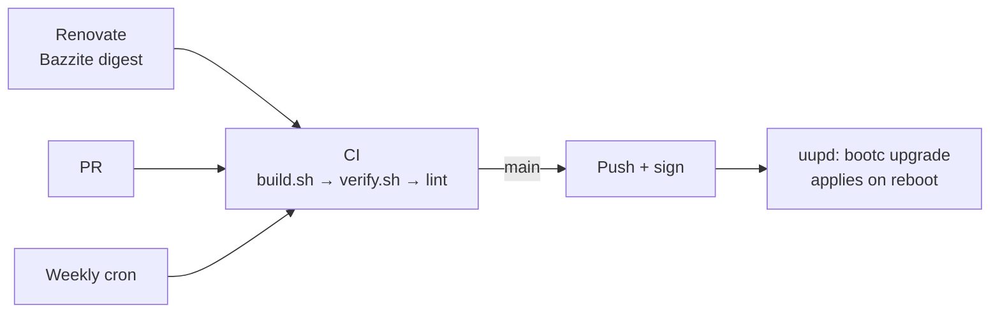

# os_build

`ghcr.io/bourbonfgiles/os_build:latest`: Bazzite GNOME (NVIDIA open) as a cosign-signed [bootc](https://bootc.dev) image, with Albert, Ghostty, eBPF tooling and the host side of the [dotfiles](https://github.com/bourbonfgiles/dotfiles) k3d cluster.

| Repo | Owns |
|---|---|
| `os_build` | The OS: packages, system config, signature policy |
| [`dotfiles`](https://github.com/bourbonfgiles/dotfiles) | `$HOME`, Homebrew, Flatpaks, GNOME settings, the k3d cluster |
| [`kube_local`](https://github.com/bourbonfgiles/kube_local) | The cluster platform |



## Files

| File | Does |
|---|---|
| `Containerfile` | `FROM bazzite-gnome-nvidia-open:stable-45` (digest-pinned), runs `build.sh`, `verify.sh`, `bootc container lint` |
| `build_files/packages` | Packages added to the base |
| `build_files/build.sh` | Installs `packages` from build-only repos, Albert autostart, enables units, adds the signature policy |
| `build_files/verify.sh` | Fails the build if the image wouldn't boot, verify updates, or ship what it should |
| `system_files/` | Copied onto `/`: cosign public key, DNS over TLS, DNS-enabled default `podman` network, rootful `podman.socket` for `wheel`, k3d logging, `kube.internal` DNS |
| `.github/workflows/build.yml` | Build, rechunk, tag; on `main` push and sign the `latest` digest |
| `.github/renovate.json5` | Bumps the base digest, automerges on green |

## Rules

- Third-party repos exist only during the build. Albert's OBS repo uses `Fedora_$releasever`, never Rawhide.
- The image is trusted by its cosign key; the default policy stays `reject`.
- Steam stays native.

## Changes

| Change | How |
|---|---|
| Add or remove a package | Edit `build_files/packages` → PR → merge |
| Update now | `sudo bootc upgrade` |
| Roll back | `sudo bootc rollback`, or the previous GRUB entry |
| Fedora 46 | PR `stable-45` → `stable-46`. Red usually means Albert's OBS has no `Fedora_46` build yet |
| Rotate the cosign key | Add the new key beside the old (`keyPaths`), build, swap `SIGNING_SECRET`, build, drop the old key |
| Cosign key lost or leaked | `cosign generate-key-pair`; new `cosign.pub` in the repo root and `system_files/etc/pki/containers/os_build.pub`; `gh secret set SIGNING_SECRET < cosign.key`; merge. Each machine rejects the new signature, so repeat install step 3. Keep `cosign.key` offline, never in the repo |

## Install

1. Bazzite GNOME NVIDIA ISO, installed to the system disk only.

   > [!CAUTION]
   > Leave the data drive unticked and never choose "reclaim space". Check with `lsblk -o NAME,SIZE,FSTYPE,MODEL` in the live session.

2. Enrol the Secure Boot key at the MOK screen.
3. Pin stock Bazzite as a fallback, then switch:

   ```
   cosign verify --key cosign.pub ghcr.io/bourbonfgiles/os_build:latest
   sudo ostree admin pin 0
   sudo bootc switch --apply ghcr.io/bourbonfgiles/os_build:latest
   ```

   This switch can't verify: Bazzite's policy doesn't know this key yet, so `cosign verify` is the check. After the reboot, enforce signatures:

   ```
   sudo bootc switch --enforce-container-sigpolicy ghcr.io/bourbonfgiles/os_build:latest
   ```
4. Run `dotfiles`' `bootstrap.sh`.

## Troubleshooting

Start with `sudo bootc status` and `journalctl -u uupd -b`.

| Symptom | Cause | Fix |
|---|---|---|
| CI: `Could not depsolve` … `nothing provides libQt6Core…` | A repo built for a newer Fedora than the base | Point it at `Fedora_$releasever`, or wait |
| CI: `VERIFY FAILED: …` | A guard caught a broken image | Fix the cause, never the check |
| CI: `Lint warning:` / `Lint error:` | Files left in `/run`, `/tmp` or `/var` | `tmpfs` mount for that path in the `Containerfile` |
| `Cannot connect to the Docker daemon` | `podman.socket` down, or not in `wheel` | `systemctl status podman.socket` |
| `*.kube.internal` doesn't resolve | Cluster down or unit failed | `kube-up`, `systemctl status kube-internal-dns`, `resolvectl status k3d0` |
| Rootful container's `/etc/resolv.conf` lists `1.1.1.1` | `/etc/containers/networks/podman.json` missing or edited | Restore from `system_files/`, `sudo systemctl restart podman.socket` |
| No update for over a week | CI failing, Renovate stopped, workflow disabled | Actions tab, Renovate's dashboard issue |
| `A signature was required, but no signature exists` | Signing step failed | The "Sign container image" step |
| `cryptographic signature verification failed` | `SIGNING_SECRET` doesn't match the image's public key | Rotate as above |
| Boots but GPU or a game is broken | Base or package regression | `sudo bootc rollback`; diff `rpm -qa` between deployments |
